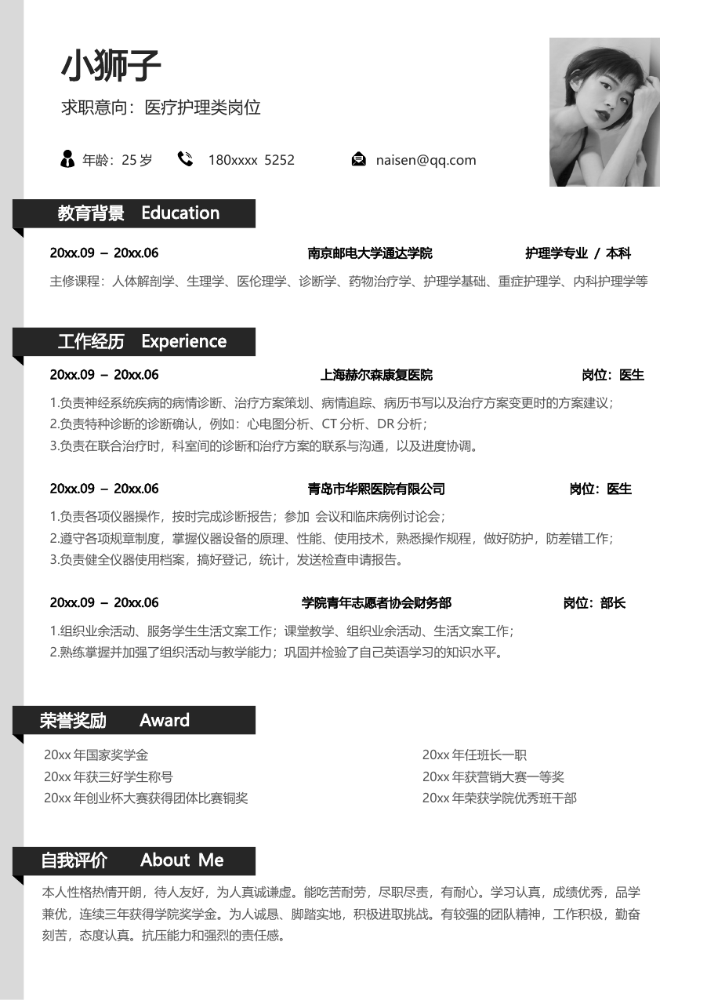
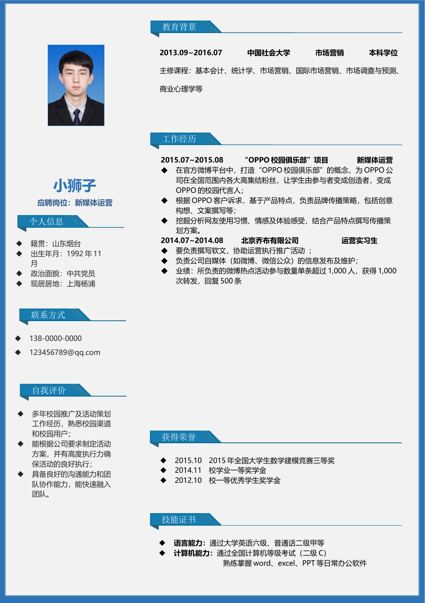
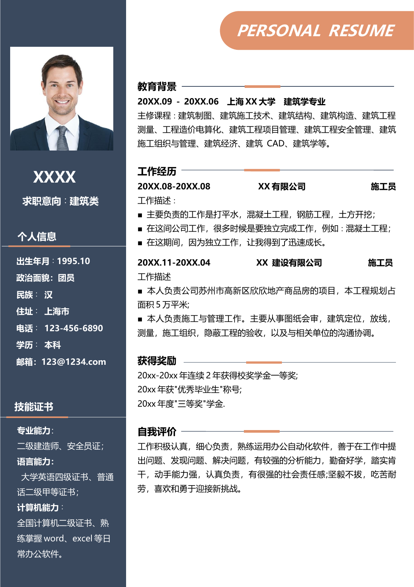
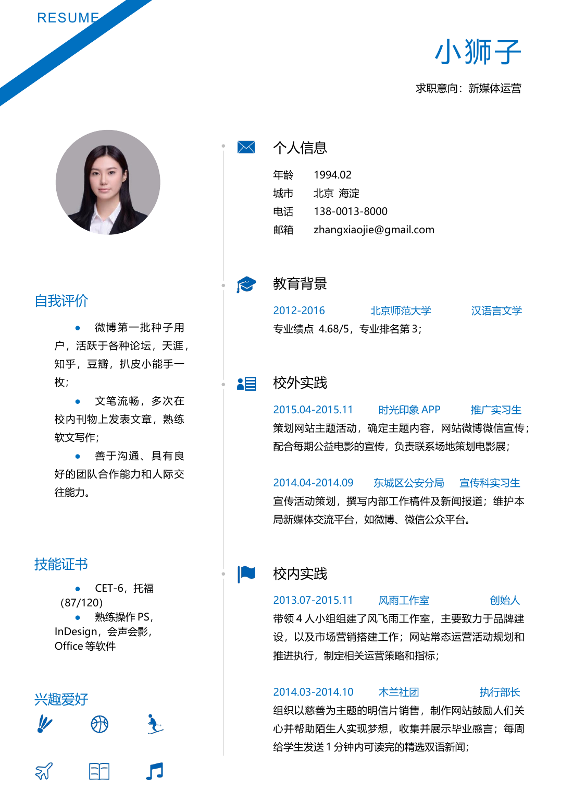
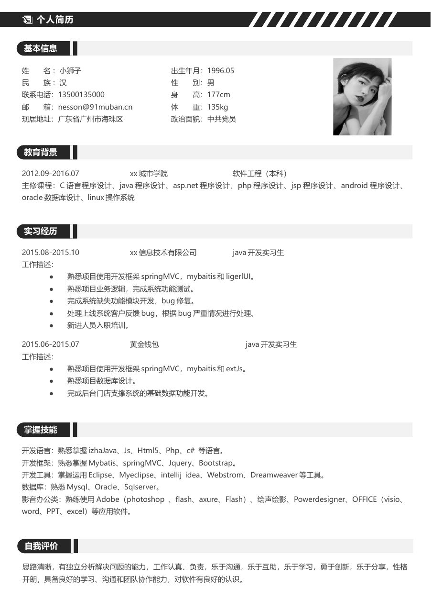
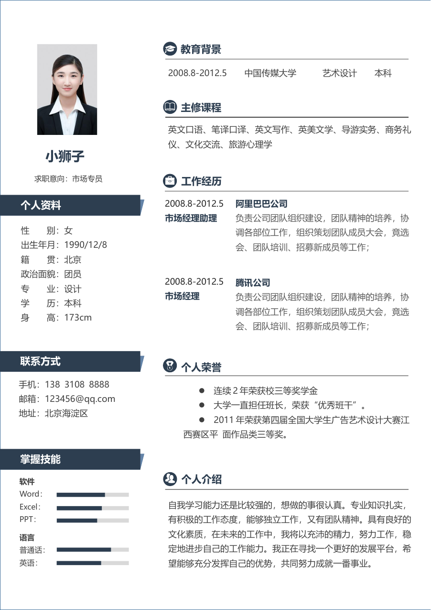
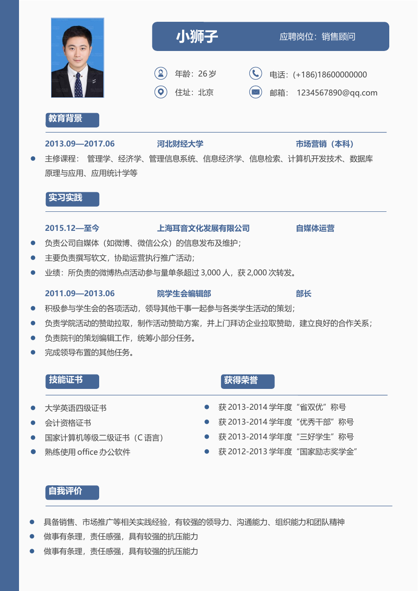
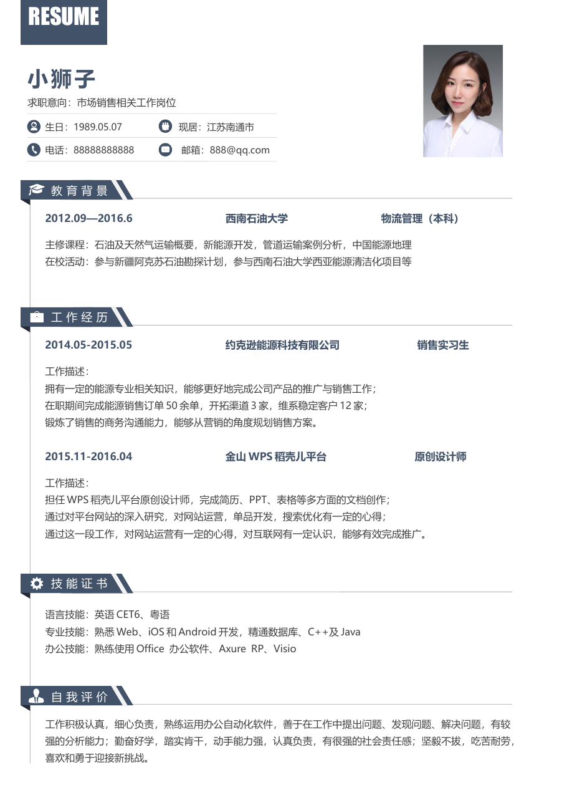
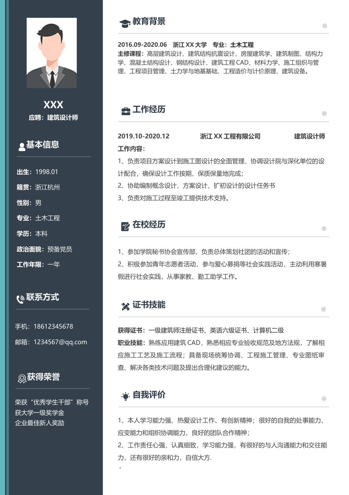

# 模板样式目录

用户提供的9份Word源模板，按原文件1—9对应T01—T09。所有原文和人像仅为示例，不是候选人信息。未发现附带明确分发条款；保留原文件，原作者权利不因收录改变。

只能使用T01—T09，不提供其他内置版式或默认兜底。正文确认后展示样式预览、编号与简短风格说明，等待用户明确选定编号；用户要看全部则展示全部。用户没有偏好也需要选编号，可以推荐但不能替选。已有明确选择则沿用，不重复询问。

|编号|风格|源文件|本地源模板检查|
|---|---|---|---|
|T01|黑白标题单栏|[Word](../assets/catalog/T01.docx)|源样例可读；实际填充仍需检查|
|T02|蓝色边框侧栏|[Word](../assets/catalog/T02.docx)|已局部修复并检查源样例单页；填充后仍需检查|
|T03|深蓝橙色侧栏|[Word](../assets/catalog/T03.docx)|已局部修复并检查源样例单页；填充后仍需检查|
|T04|蓝色斜线双栏|[Word](../assets/catalog/T04.docx)|已局部修复并检查源样例单页；填充后仍需检查|
|T05|黑白条纹单栏|[Word](../assets/catalog/T05.docx)|源样例可读；实际填充仍需检查|
|T06|深蓝信息侧栏|[Word](../assets/catalog/T06.docx)|源样例可读；实际填充仍需检查|
|T07|蓝色圆角单栏|[Word](../assets/catalog/T07.docx)|源样例可读；实际填充仍需检查|
|T08|蓝灰标签单栏|[Word](../assets/catalog/T08.docx)|源样例可读；实际填充仍需检查|
|T09|深色图标侧栏|[Word](../assets/catalog/T09.docx)|已局部修复并检查源样例单页；填充后仍需检查|

## 预览
以下为当前模板样例预览，仅供选样式，不能作为用户简历交付。

### T01 黑白标题单栏

### T02 蓝色边框侧栏

### T03 深蓝橙色侧栏

### T04 蓝色斜线双栏

### T05 黑白条纹单栏

### T06 深蓝信息侧栏

### T07 蓝色圆角单栏

### T08 蓝灰标签单栏

### T09 深色图标侧栏

## 填充要求
在源模板副本上编辑，必须保留对应源模板结构，不得另建版式冒称原样式。清除示例文字、替换用户照片；未填写字段标待补充，未上传照片则标照片待上传或示例照片·待上传替换。无关经历模块删除。原样例含浮动对象/文本框，兼容结构可能重复，须检查所有可见文字和每页渲染。不允许另建简单单栏冒充套版。无法读取/编辑所选文件时说明具体失败；先尝试宿主其他可用编辑工具，不擅自换模板。
