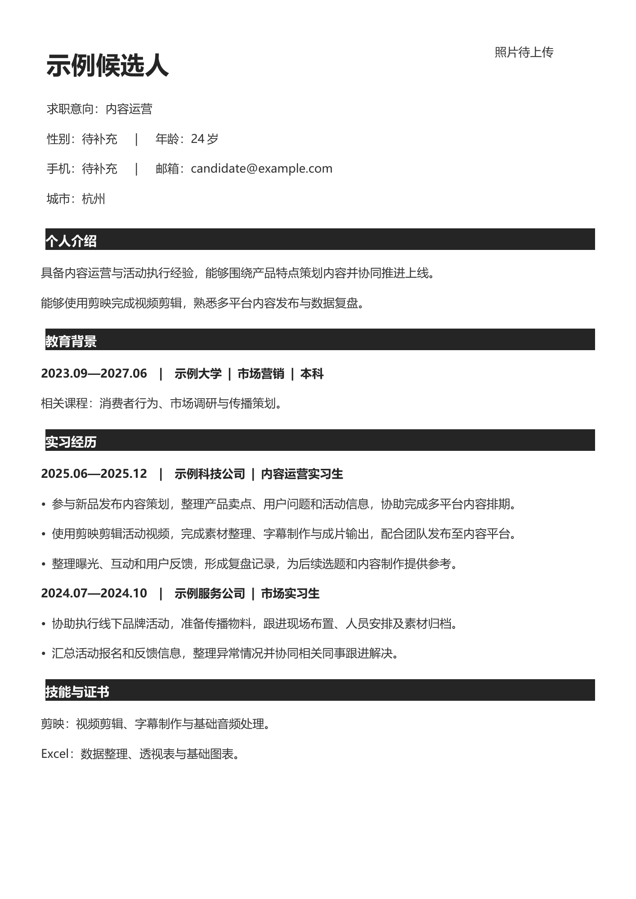
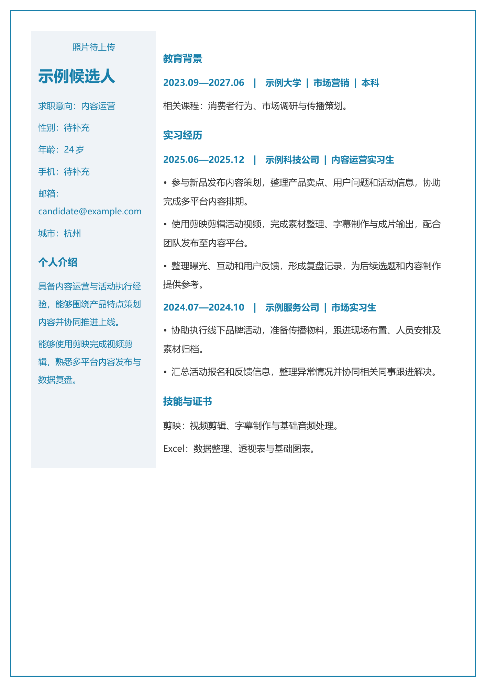
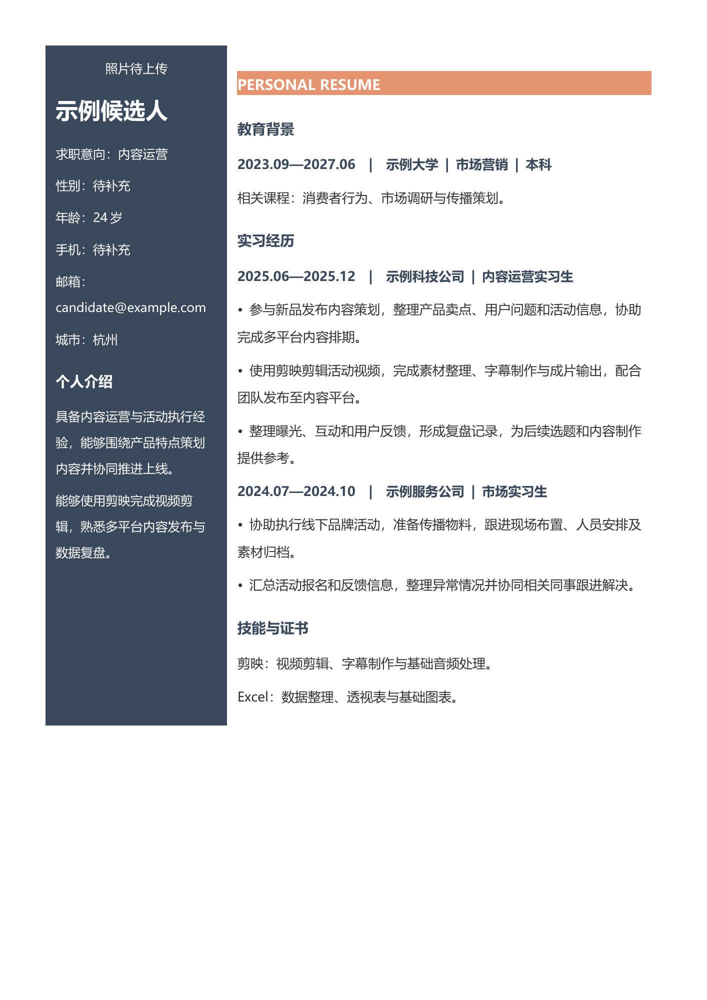
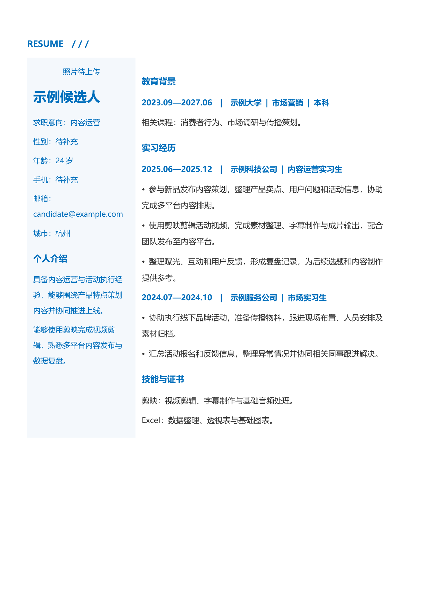
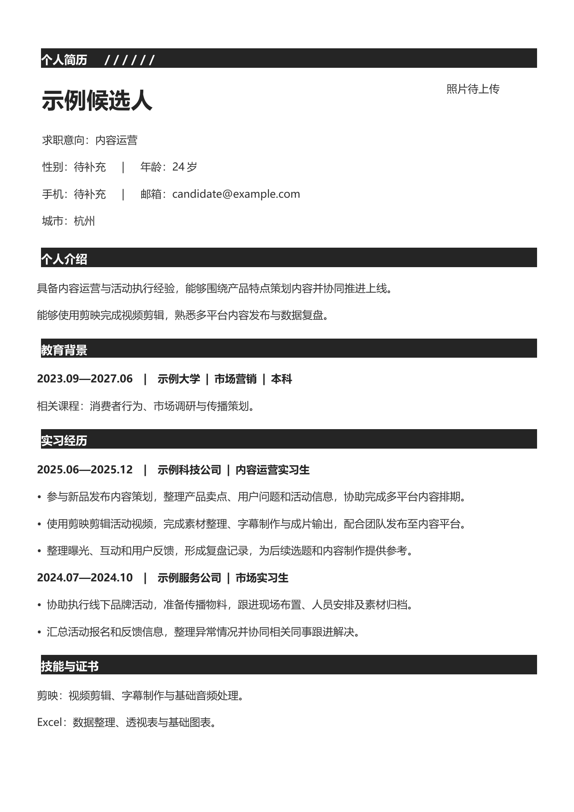
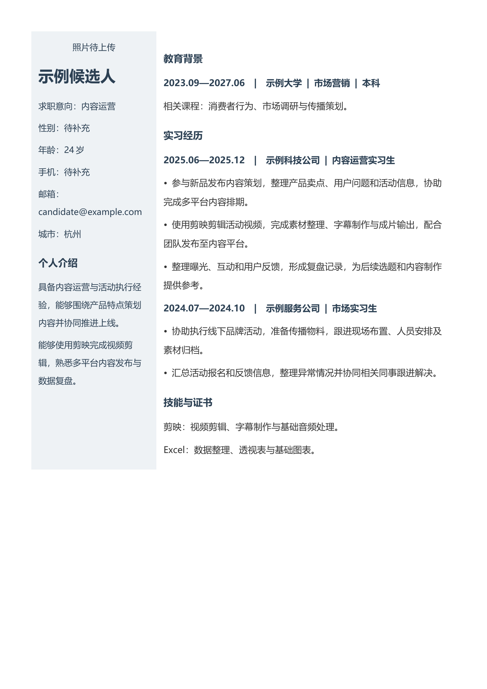
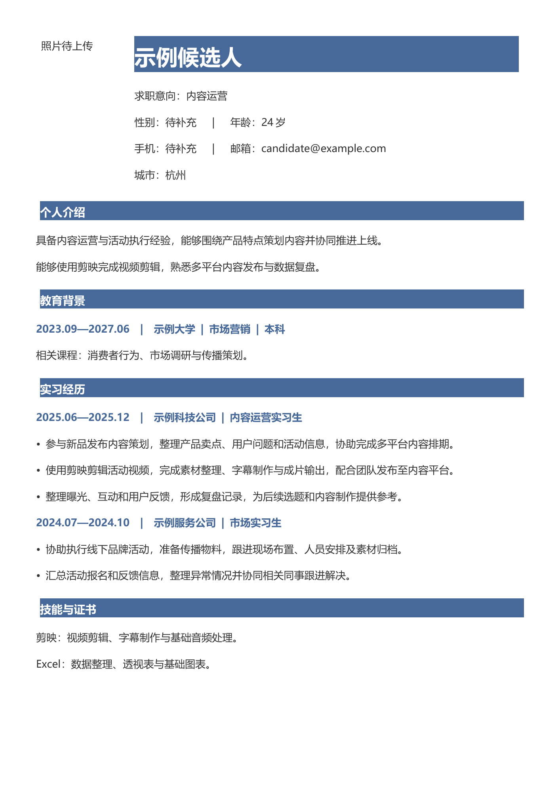
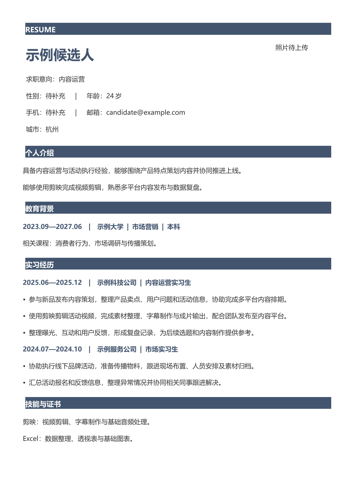
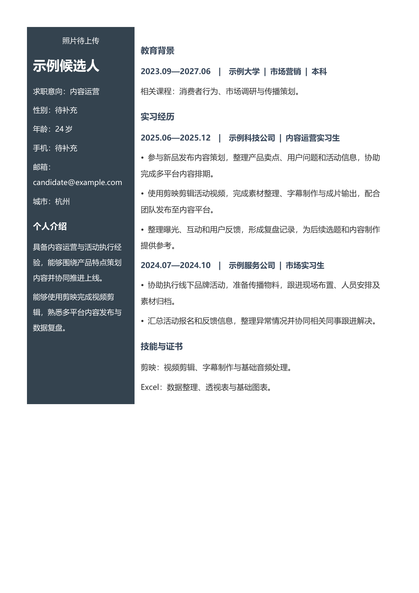

# 模板样式目录

用户提供的9份Word样式，按原文件1—9对应T01—T09。1.5提供自动填充整理版：保留主要配色与栏结构，简化浮动装饰，改为流式正文和行内照片以缩短生成时间。下列预览展示实际自动填充版；原文件保留在catalog参考，不在用户交付时重新研究。所有原文和人像仅为示例，不是候选人信息。未发现附带明确分发条款；保留原文件，原作者权利不因收录改变。

只能使用T01—T09，不提供其他内置版式或默认兜底。正文确认后展示样式预览、编号与简短风格说明，等待用户明确选定编号；用户要看全部则展示全部。用户没有偏好也需要选编号，可以推荐但不能替选。已有明确选择则沿用，不重复询问。

|编号|风格|自动填充文件|本地检查|
|---|---|---|---|
|T01|黑白标题单栏|[Word](../assets/ready/T01.docx)|自动填充样例已检查；实际内容仍需检查|
|T02|蓝色边框侧栏|[Word](../assets/ready/T02.docx)|自动填充样例已检查；实际内容仍需检查|
|T03|深蓝橙色侧栏|[Word](../assets/ready/T03.docx)|自动填充样例已检查；实际内容仍需检查|
|T04|蓝色双栏|[Word](../assets/ready/T04.docx)|自动填充样例已检查；实际内容仍需检查|
|T05|黑白条纹单栏|[Word](../assets/ready/T05.docx)|自动填充样例已检查；实际内容仍需检查|
|T06|深蓝信息侧栏|[Word](../assets/ready/T06.docx)|自动填充样例已检查；实际内容仍需检查|
|T07|蓝色标题单栏|[Word](../assets/ready/T07.docx)|自动填充样例已检查；实际内容仍需检查|
|T08|蓝灰标签单栏|[Word](../assets/ready/T08.docx)|自动填充样例已检查；实际内容仍需检查|
|T09|深色侧栏|[Word](../assets/ready/T09.docx)|自动填充样例已检查；实际内容仍需检查|

## 预览
以下为当前自动填充版合成样例预览，仅供选样式，不能作为用户简历交付。

### T01 黑白标题单栏

### T02 蓝色边框侧栏

### T03 深蓝橙色侧栏

### T04 蓝色双栏

### T05 黑白条纹单栏

### T06 深蓝信息侧栏

### T07 蓝色标题单栏

### T08 蓝灰标签单栏

### T09 深色侧栏

## 填充要求
用户选择的是上述实际自动填充版；使用generate_resume.py，按编号读取ready源文件，保留对应风格，模块随内容流动。不可默默选择另一编号，也不可回到旧浮动文本框现场研究。原catalog样式的细节存在简化，不能宣称像素级一致。预览例文和人物都不是候选人材料。
